# Architecture and trust boundaries

```mermaid
flowchart LR
  U[Untrusted request / text] --> R[Deterministic request validation]
  R --> A[Bounded agent adapter\npublic context only]
  A --> P[Untrusted structured result]
  P --> S[Closed Terraform JSON policy\nand retention-only diff check]
  S --> B[Proposal bundle\ncode + assumptions + provenance]
  B --> G[Isolated Git clone\nstable branch and PR]
  G --> V[Unprivileged PR checks\nfmt, validate, mocked tests]
  V --> H[Human review and merge]
  H --> D[Manual dispatch\nexplicit target + merged revision]
  D --> E[Protected environment approval\nshort-lived identity]
  E --> T[Real plan\nremote state lock + policy]
  T --> Q[Review sanitized plan and digest]
  Q --> I[Separate authorized apply dispatch\nreplan digest must match]
  I --> X[Apply exact saved local plan]
  X --> F[Provider refresh / no-change plan]
  F --> O[Sanitized summary and report artifact]
  L[Untrusted selected run logs] --> C[Bounded collection and redaction]
  C --> N[Evidence-linked diagnosis\nunknowns and next check]
```

The model has no infrastructure permission. Its output never supplies commands, paths, token scopes or approvals. The adapter runs in an empty temporary directory with a read-only Codex sandbox, approval disabled and user configuration excluded. Only validated public requests and selected configuration enter the prompt. A local CLI sandbox is not a substitute for a hardened multi-tenant isolation boundary: run under a dedicated OS account or isolated runner if the host contains sensitive files. The CLI itself needs authentication, and its filesystem-reading tools are not a proven secret-exfiltration boundary. Do not feed private context to this reference.

The proposal policy evaluates parsed JSON, not model-written scripts. It allows one module source, two demonstration identities, integer retention 1–30, bounded literal labels, and two exact optional references. It rejects all other Terraform blocks and expressions. A retention proposal must preserve every field except retention. All generated candidates remain untrusted until review, even when policy passes.

The create example targets `dev/new-app`; the retention example targets `dev/app`, whose configuration is a checked-in baseline. Neither baseline asserts that a cloud resource actually exists. The separate identities avoid a misleading no-op creation example. They share an environment concurrency group.

A local advisory `flock` prevents overlapping operations using the same lock directory. Hosted proposal and execution jobs share `reviewed-devops-dev` with cancellation disabled; Terraform backend locking handles independent clients that share state. Local locks do not coordinate machines. GitHub concurrency is not a durable FIFO queue: pending requests can be superseded. Review the actual run history; do not promise every dispatch will execute. There is no cross-repository global environment lock.

Publication uses a temporary clone, a stable target/operation branch and an open-PR lookup. Identical repeated proposals return the existing PR. Updates use a Git lease to detect competing publication; a moved base requires regeneration. Local publication produces a portable Git branch bundle and a PR description without GitHub credentials. The worktree stays intact.

Real planning is privileged: providers are executable code, may read credentials and call external APIs. The execution workflow checks out trusted main, accepts only a full SHA merged into main, and copies only known Terraform files from that reviewed revision. Do not bypass module/provider/workflow review. Pinning a provider does not make arbitrary Terraform harmless. PR validation gets no secrets, no OIDC write permission, and no persisted checkout credential. There is no `pull_request_target` or privileged `workflow_run` bridge.

Cloud apply is disabled until the owner configures state, OIDC, repository opt-in and protected environments. Plan and apply have separate environments; configure different roles, with plan access scoped as narrowly as provider refresh permits. Apply replans, rejects deletions/replacements/unapproved resource types, checks the prior reviewed digest, and applies that exact locally saved plan. `prevent_destroy` is additional defense for the bucket; it does not protect against object expiry or out-of-band deletion. Reducing expiration can remove existing data sooner and needs informed review.

Raw state, saved plans and raw provider logs remain temporary runner data. Only known report paths are uploaded. Apply failure, timeout or uncertain verification reports incomplete work and never triggers destroy, force-unlock or automatic rollback. A failed operation can still have changed AWS. Investigate state and provider evidence before retrying.

This design can extend to drift proposals, dependency changes, resizing and decommissioning. Each needs its own validated request shape, allowed-diff policy, tests, review rules and verification. Destructive decommissioning requires a separate authorization design; it is not implemented here.
